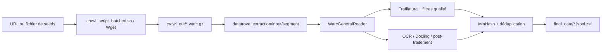
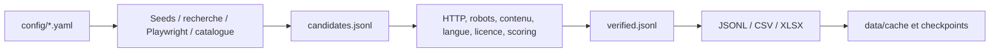

# Audit d’intégration — crawler et collecteur marocain

Date : 2026-07-13. Périmètre : audit statique, sans crawl, API ni lecture de `.env`.

## 1. Résumé exécutif

Le crawler est un assemblage de deux exécutables : un script Bash/Wget qui prend une URL ou un fichier de seeds et génère des WARC, puis un pipeline Python Datatrove qui lit des WARC et écrit des JSONL dédupliqués. Le collecteur est une application Python distincte, déjà structurée en ETL et testée. Son format le plus adapté à une intégration est le JSONL, mais **pas ses deux sorties actuelles telles quelles** : les schémas divergent et aucun contrat de version n’existe.

Recommandation : **option A — manifeste JSONL versionné + adaptateur local dans le crawler**. Elle préserve les entrées historiques du script Wget, évite les imports entre dépôts et n’exige pas de fusion massive. L’intégration doit viser le script réellement présent `crawl_script_batched.sh`, et non le nom `crawl_script.sh` encore cité par la documentation.

## 2. Situation Git et organisation du workspace

### Faits observés

- Le dépôt Git racine est `C:\Users\BadrJOULALI\Documents\moroccan-ai-data` ; branche `master`.
- Son état contient de nombreuses modifications dans `moroccan_sources_collector/` et le répertoire entier `crawler_project-main/` est non suivi. Ces changements doivent être protégés.
- `moroccan_sources_collector/.git` existe : c’est un dépôt imbriqué. Ses commandes Git n’ont pas pu être lues, car Git refuse l’emplacement pour « dubious ownership ». Aucune modification de configuration Git n’a été faite.
- `crawler_project-main/` ne contient pas de `.git` détectable et son projet effectif est `crawler_project-main/crawler_project-main/`. Il ressemble donc à une copie/ZIP extraite plutôt qu’à un clone Git vérifiable.
- Aucun remote n’a été affiché par le dépôt racine. Les URL de remote du dépôt imbriqué restent inconnues à cause du blocage Git.

### Conclusion

La copie canonique du crawler doit être confirmée auprès de l’équipe avant toute intégration : en l’état, le crawler est non suivi dans le dépôt racine et ne peut pas être identifié comme copie canonique. Le collecteur doit rester un dépôt autonome durant la transition.

## 3. Inventaire du crawler

- Entrées : `crawling/crawl_script_batched.sh` (l. 92–153) accepte une URL ou un fichier de seeds ; `crawling/file.txt` est l’exemple historique.
- Crawling : Wget récursif produit des `.warc.gz` dans `crawling/crawl_out/<prefix>/`.
- Extraction : `datatrove_extraction/process.py:117` lit les WARC de `input/segment-2026-01` et orchestre les étapes Datatrove.
- Sorties : `output/<segment>/final_data/html` et `pdfs`, en JSONL Zstandard ; `crawled_dataset/` existe mais aucun code inspecté ne le désigne comme destination active.
- Cache : `models_cache/`, référencé par `process.py` (modèle OCR l. 93).
- Configuration : Python >=3.11, dépendances dans `pyproject.toml`; `.env.example` décrit un endpoint/modèle LLM, sans lecture du vrai `.env`.
- Tests : aucun répertoire ou configuration de tests n’a été trouvé dans le crawler. Aucune commande de test documentée n’a donc été exécutée.

## 4. Inventaire du collecteur

- Point d’entrée CLI : `src/main.py:939–1006`, commande par défaut `uv run python -m src.main`; commandes historiques `collect`, `verify`, `export`, `run-all`, `audit-links`.
- Pipeline MVP : `run_mvp_etl` (`src/main.py:486–508`) exécute extract → transform → load.
- Découverte : seeds YAML, Playwright, adaptateurs de recherche et extraction de liens (`src/discovery/`). L’expansion utilise aussi une file `deque` (`src/expansion/discovery_expander.py:118–153`).
- Validation : URL/HTTP (`validation/url_checker.py:40`), robots (`robots_checker.py:22`), type de contenu, licence et analyse linguistique.
- Normalisation/déduplication : `utils/url_utils.py:24–70`, avec retrait de paramètres de tracking ; détection de doublons dédiée dans `expansion/duplicate_detector.py`.
- Stockage : JSONL, CSV, XLSX via `src/storage/`. Caches JSON sous `data/cache/`; intermédiaires sous `data/intermediate/`.
- Dépendances : Python >=3.11 ; Playwright, httpx, requests, pandas, openpyxl, PyYAML, tldextract, tenacity, trafilatura, etc. (`pyproject.toml`).
- Secrets : seulement trois hooks de recherche vides dans `.env.example`; le vrai `.env` n’a pas été lu.
- Tests : 11 fichiers sous `tests/`, configurés par `pyproject.toml`.

## 5. Architecture actuelle du crawler



## 6. Architecture actuelle du collecteur



## 7. Flux de données actuels

Le crawler ne consomme que des URLs texte ou un fichier ligne par ligne, puis des WARC. Le collecteur produit :

- `src/main.py` : candidats compacts (`url`, `source_name`, `source_url`, `source_category`, `source_priority`, `discovery_method`, `depth`, `anchor_text`) — preuve `candidate_to_dict`, l. 511–522 ; catalogue métier riche — preuve `_base_record`, l. 586–607 et `CATALOG_COLUMNS`, `storage/excel_exporter.py:13–22`.
- `collect_moroccan_websites.py` autonome : `PageRecord` de dix champs (`url`, `domaine`, titre, description, catégorie, score, confiance, provenance, date, statut) — l. 234–247. Son fichier `moroccan_websites.jsonl` observé a exactement ces clés.

Ces schémas ne sont pas interchangeables. CSV/XLSX sont des sorties de consultation ; JSONL est le meilleur format d’interface grâce au streaming, UTF-8 et à l’absence de formules Excel.

## 8. Résultats des tests et vérifications

| Commande | Résultat |
|---|---|
| `uv run pytest -q` dans `moroccan_sources_collector` | Succès : 47 tests passés (`...............................................`). |

Cette seule commande est à la fois documentée dans le README et configurée par `pyproject.toml`. Aucun crawl ni appel réseau n’a été exécuté. Aucune vérification configurée de lint/type/format n’a été trouvée. Aucun test du crawler n’a été trouvé.

## 9. Points forts

- Collecteur : séparation claire discovery/validation/analysis/storage, normalisation réutilisable et tests couvrant URL, score, Darija, expansion, Excel et extracteurs.
- Crawler : WARC durable, contrôle de profondeur, délai, timeout, retries, redirections, quotas, batching et logs dans `crawl_script_batched.sh:179–214, 287–345`.
- Extraction : pipeline multi-étapes avec filtrage et MinHash, sorties d’exclusion et JSONL comprimé (`process.py:121–277`).

## 10. Problèmes et risques

| ID | Sévérité | Projet | Fichier/symbole | Observation | Risque | Recommandation | Effort |
|---|---|---|---|---|---|---|---|
| P1 | Critique | Workspace | Git | crawler non suivi, dépôt collecteur imbriqué inaccessible à Git | intégration sur mauvaise copie/perte de travail | confirmer le dépôt canonique puis intégrer sur une branche dédiée | M |
| P2 | Élevée | Crawler | `crawling/crawl_script_batched.sh:186,298` | `ROBOTS` vaut `off` par défaut | crawl non conforme aux règles publiées | rendre `on` par défaut et exiger une dérogation explicite | S |
| P3 | Élevée | Intégration | entrées/sorties | pas de contrat versionné ; trois schémas collecteur | erreurs silencieuses ou seeds mal interprétés | manifeste v1 validé par adaptateur | M |
| P4 | Moyenne | Crawler | README vs fichiers | README appelle `crawl_script.sh` et `helpers/get_sitmaps.py`, absents ; présents : `crawl_script_batched.sh`, `append_sitemaps.py` | procédure non exécutable | corriger la documentation avec les noms réels | XS |
| P5 | Moyenne | Crawler | `process.py:56,95` | segment `segment-2026-01` codé en dur et comptage de sous-répertoires à l’import | faible paramétrabilité/échec si entrée absente | déplacer vers arguments/config, initialiser dans `main` | M |
| P6 | Moyenne | Collecteur | `collect_moroccan_websites.py` | script autonome parallèle au package, exports à la racine et règles URL distinctes | dérive fonctionnelle et confusion du format à consommer | le traiter comme outil séparé ou le faire exporter le contrat commun | M |
| P7 | Moyenne | Crawler | `crawl_script_batched.sh:340–344` | les échecs Wget sont transformés en succès du script | orchestration incapable de détecter un lot échoué | produire un statut par lot et retourner un code non nul selon règle explicite | S |
| P8 | Faible | Collecteur | `storage/jsonl_exporter.py:18–22` | charge le fichier complet en mémoire et échoue à la première ligne JSON invalide | pas de reprise d’un manifeste partiellement corrompu | lecteur streaming avec rejet journalisé par ligne | S |
| P9 | Amélioration | Crawler | `main.py:1–7` | point d’entrée projet ne lance aucun pipeline | interface publique ambiguë | conserver le message ou documenter une CLI unifiée sans changement massif | S |

## 11. Matrice de compatibilité

| Axe | Collecteur | Crawler | Verdict |
|---|---|---|---|
| Représentation URL | dict, champs multiples et normalisation Python | URL brute, une ligne par seed | adaptateur requis |
| Schéma | compact, métier riche, autonome minimal | aucune métadonnée de seed | bloquant sans contrat |
| Encodage | JSONL UTF-8, CSV UTF-8-SIG | fichier texte non spécifié | fixer UTF-8 |
| Formats | JSONL/CSV/XLSX | texte/WARC/JSONL.zst | JSONL + génération texte |
| Chemins | `Path` relatifs au package | Bash relatif au script | passer chemins absolus/configurés |
| Déduplication | URL normalisée/fingerprint | Wget + MinHash contenu aval | dédupliquer au manifeste |
| Statut/robots | statuts métier et vérification robots | robots configurable, défaut off | contradiction à résoudre |
| Logs/erreurs | logging Python, cache | fichiers Wget, `print` | corrélation par run_id souhaitable |
| Dépendances/Python | >=3.11, HTTP/Playwright | >=3.11, Datatrove/Wget | pas de conflit nécessaire si séparation processus |
| Sync/async | mixte async et sync | Bash puis exécuteurs locaux | compatible via fichier |
| CLI/tests | argparse et 47 tests | Bash/Python, aucun test trouvé | ajouter adaptateur testé |

## 12. Points d’intégration possibles

1. Avant Wget : convertir le manifeste validé en fichier de seeds UTF-8.
2. À l’orchestration : chaîner collecteur, validation du manifeste, Wget puis déplacement/copier contrôlé des WARC vers l’entrée Datatrove.
3. Après extraction : conserver le `source_id`/provenance dans un manifeste de run plutôt que de modifier les WARC ou le lecteur immédiatement.

## 13. Comparaison des options d’intégration

| Critère | A — manifeste + adaptateur | B — `SourceProvider` Python | C — orchestrateur externe |
|---|---|---|---|
| Impact crawler | faible, ajoute lecteur/générateur de seeds | moyen, refactorise interface | faible dans le code |
| Impact collecteur | ajoute export contractuel | dépend d’une API crawler | aucun ou faible |
| Couplage | faible par fichier versionné | élevé, imports/package | faible, mais orchestration externe |
| Compatibilité ascendante | excellente | à concevoir | excellente |
| Testabilité | élevée, fixtures JSONL | élevée mais intégration plus large | moyenne |
| Déploiement | simple | environnement Python partagé | outillage additionnel |
| Risque | faible | moyen/élevé | moyen |
| Effort | M | L | M |

## 14. Architecture recommandée

Choix : **A**. Le crawler appelle déjà Wget avec un fichier multi-URL et le collecteur sait exporter JSONL. Ajouter un adaptateur indépendant, sans import entre projets, correspond exactement à ces interfaces observées. Le manifeste est la source de vérité ; le fichier Wget est un artefact dérivé, jetable et reproductible.

## 15. Contrat de données proposé

Format : JSONL UTF-8, un objet par ligne, `schema_version: "1.0"`. Champs requis : `schema_version: str`, `source_id: str` (SHA-256 de l’URL canonique), `url: str`, `domain: str`, `discovered_at: str` ISO-8601 UTC, `discovery_method: str`, `validation_status: str`. Optionnels : `source_name`, `category`, `languages: list[str]`, `country` ("MA"), `confidence: float` [0,1], `provenance_url`, `robots_status`, `http_status`, `final_url`, `metadata: dict`.

Règles : URL HTTP(S) absolue ; normaliser en retirant tracking, minuscules domaine, fragment supprimé ; dédupliquer par `source_id`; conserver première occurrence et journaliser les suivantes ; dates UTC ; statuts `validated|pending_review|rejected`; un enregistrement invalide est ignoré et journalisé avec numéro de ligne ; fichier partiellement corrompu reste exploitable ligne à ligne. La reprise repose sur un manifeste immuable et une sortie seeds déterministe triée par `source_id`.

Modèle indicatif (dataclass : Pydantic n’est pas une dépendance du collecteur) :

```python
@dataclass(frozen=True)
class CrawlSourceV1:
    schema_version: str
    source_id: str
    url: str
    domain: str
    discovered_at: str
    discovery_method: str
    validation_status: str
    source_name: str | None = None
    category: str | None = None
    languages: list[str] = field(default_factory=list)
    country: str = "MA"
    confidence: float | None = None
    provenance_url: str | None = None
    robots_status: str | None = None
    http_status: int | None = None
    final_url: str | None = None
    metadata: dict[str, object] = field(default_factory=dict)
```

Valide : `{"schema_version":"1.0","source_id":"<sha256>","url":"https://example.ma/a","domain":"example.ma","discovered_at":"2026-07-13T12:00:00Z","discovery_method":"catalog_link","validation_status":"validated"}`.

Invalide : `{"url":"ftp://example.ma","validation_status":"ok"}` (version, identifiant, domaine, date et statut autorisé absents/invalides).

## 16. Plan fichier par fichier

| Ordre | Action | Fichier | Type | Responsabilité | Risque | Tests |
|---|---|---|---|---|---|---|
| 1 | Créer | `moroccan_sources_collector/src/contracts/crawl_source.py` | nouveau | dataclass + validation/normalisation v1 | faible | unités contrat |
| 2 | Créer | `moroccan_sources_collector/src/storage/crawl_manifest_exporter.py` | nouveau | exporter JSONL déterministe | faible | export/idempotence |
| 3 | Modifier | `moroccan_sources_collector/src/main.py` | CLI minimale | ajouter sous-commande explicite d’export, sans changer MVP | moyen | compatibilité CLI |
| 4 | Créer | `crawler.../crawling/helpers/manifest_to_seeds.py` | nouveau | valider JSONL et écrire fichier seeds | faible | fixtures invalides/corrompues |
| 5 | Modifier | `crawler.../crawling/crawl_script_batched.sh` | option d’entrée | accepter `--source-manifest` ou un fichier seeds généré ; conserver les deux arguments historiques | moyen | shell local/mocks Wget |
| 6 | Créer | `crawler.../crawling/tests/` | tests | non-régression adaptateur/script | moyen | e2e local |
| 7 | Modifier | README des deux projets | documentation | procédure et noms script réels | faible | revue manuelle |

À ne pas toucher dans la première intégration : `datatrove_extraction/process.py`, les lecteurs WARC, les filtres et les formats de données extraites. Cela évite un changement massif de `main.py` et conserve le comportement aval.

## 17. Exemples de pseudo-code ou pseudo-diff

```python
# manifest_to_seeds.py
for line_number, row in iter_jsonl(manifest):
    source = CrawlSourceV1.from_mapping(row)
    if source.validation_status != "validated":
        continue
    if source.robots_status == "Non":
        continue
    urls.add(normalize_url(source.final_url or source.url))
seed_file.write_text("\n".join(sorted(urls)) + "\n", encoding="utf-8")
```

Le script Bash reçoit le fichier ainsi produit sans changer l’appel Wget : `crawl_script_batched.sh generated_seeds.txt prefix`.

## 18. Plan de tests

- `moroccan_sources_collector/tests/contracts/test_crawl_source.py` : champs, URL, date, statut, ID, métadonnées.
- `tests/storage/test_crawl_manifest_exporter.py` : ordre stable, UTF-8, déduplication, reprise.
- `crawler.../crawling/tests/test_manifest_to_seeds.py` : JSONL valide, vide, ligne invalide, partiellement corrompue, doublons, `robots=Non`.
- Fixtures locales : `valid_manifest.jsonl`, `legacy_seed_urls.txt`, `invalid_rows.jsonl`, `duplicate_urls.jsonl`, mini WARC fixe si l’enchaînement extraction doit être testé.
- Intégration sans réseau : collecteur → manifeste → adaptateur → seeds ; mock de Wget ; test de compatibilité de `file.txt` historique.
- Régression : test de reprise avec même manifeste, deux exécutions donnent les mêmes seeds ; e2e avec très petit jeu local uniquement.

## 19. Plan de migration

1. Ajouter le contrat et fixtures sans l’activer.
2. Ajouter l’export du manifeste et l’adaptateur.
3. Ajouter un mode explicite, par exemple `--source-manifest <fichier>` au wrapper de crawling, en gardant URL/fichier.
4. Produire manifeste et seeds en parallèle avec le flux historique ; comparer les listes.
5. Activer sur un petit lot contrôlé avec `ROBOTS=on`, quota et logs par run.
6. Stabiliser après tests de non-régression et documentation.

## 20. Stratégie de rollback

Le rollback est immédiat : ne plus passer `--source-manifest` et appeler le script avec le fichier de seeds historique. Le manifeste et les WARC sont conservés avec un identifiant de run ; aucun changement du pipeline Datatrove n’étant requis, aucun rollback de format aval n’est nécessaire.

## 21. Roadmap priorisée

1. Bloquer l’intégration jusqu’à confirmation du dépôt crawler canonique et protection des modifications locales.
2. Corriger la divergence documentaire et activer robots par défaut dans une future modification approuvée.
3. Implémenter contrat + export JSONL + adaptateur + tests.
4. Exécuter le mode parallèle local, puis un crawl contrôlé seulement après autorisation.

## 22. Hypothèses, limites et décisions à valider

- Hypothèse : le fichier multi-URL Wget est l’interface stable voulue ; elle est attestée par le script, mais pas par une API Python.
- Hypothèse : le collecteur package (`src/main.py`) est le produit cible ; le script autonome est un outil parallèle non suivi.
- Limite : l’origine Git exacte et les remotes du collecteur ne sont pas vérifiables tant que l’ownership Git n’est pas explicitement autorisé.
- Décision à valider : dépôt/branche canonique du crawler, politique robots (fortement recommandé : `on`), et conservation des métadonnées de provenance après la phase WARC.
